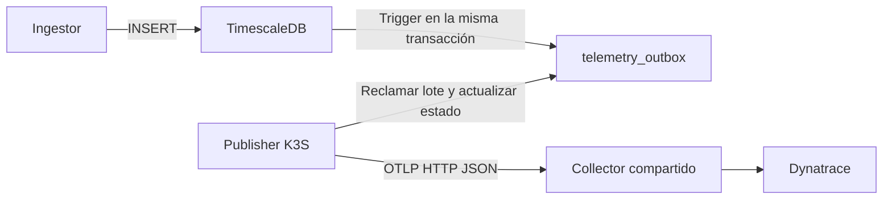

# OTLogger Publisher 0.3.1

Proceso independiente que publica CPU y RAM desde una outbox PostgreSQL hacia
el Collector compartido. También publica tags numéricas seleccionadas mediante
un CSV de configuración; las muestras se leen del outbox, no del CSV.



## Preparación DEV

1. Revisar esquema y versión reales en `idl/kepserver_pcn`. Aplicar una vez
   `migrations/001_cpu_ram_outbox.sql` con psql y ON_ERROR_STOP. La migración
   requiere tablas CPU/RAM existentes. No convierte la columna temporal de tags.
2. La migración instala triggers y agrega sample_id UUID a nuevas muestras.
   El histórico previo queda sin UUID y no se publica automáticamente.
   El ingestor actualizado detecta las columnas sample_id y asigna UUID estables
   al lote antes de escribir, conservándolos durante sus reintentos. En versiones
   antiguas el default SQL genera el UUID, sin deduplicar reintentos ambiguos. Sus escritores deben poder
   insertar en la outbox (el trigger no eleva privilegios).
3. Crear credenciales dedicadas. El publisher requiere SELECT/UPDATE/DELETE
   sobre telemetry_outbox y conexión a la base; no requiere leer otras tablas,
   crear esquema ni permisos de superusuario. La outbox ya incluye el payload
   y sobrevive independientemente de la retención de las hypertables.
4. Crear Secret `otlogger-publisher-db` con PGHOST, PGPORT, PGDATABASE,
   PGUSER, PGPASSWORD. Usar el Service TimescaleDB real. No guardar secretos
   en Git ni copiar las credenciales del administrador.
5. Construir desde la raíz: `docker build -f publisher/Dockerfile -t
   otlogger-publisher:0.3.0 .` y cargar la imagen según el procedimiento edge.
6. Ajustar `k3s/deployment.yaml`: imagen, nodo si solo uno tiene la imagen
   importada, Service DB, endpoint e identidad del servidor medido. Aplicar
   únicamente ese manifiesto, sin desplegar otra TimescaleDB.

La outbox empieza a acumular desde que se instala la migración. Asegurar
espacio y monitoreo antes de dejarla activa. Ante problemas, detener el publisher
no detiene su acumulación. Para deshabilitar la captura de pendientes, planificar
la retirada de los triggers con el propietario de la base; eso rompe la cobertura
de ese intervalo. No eliminar la outbox con pendientes.

## Política y operación

- Una réplica inicial, estrategia Recreate. Reclamo con SKIP LOCKED y token de
  intento: una confirmación anterior no actualiza un intento nuevo.
- Lease 120 s, timeout HTTP 15 s, reintentos hasta 300 s. Una pérdida de ACK
  puede duplicar puntos; Dynatrace no deduplica por sample_id automáticamente.
- ACK completo del Collector se llama collector_accepted, no entrega final.
- Rechazo parcial: reintentar lote completo, con posibles duplicados.
- HTTP no reintentable: rejected para revisión, sin limpieza automática.
- Datos de una hora o más: expired, sin cambiar timestamps ni borrarlos.
- Limpieza interna de hasta 1000 aceptados por ciclo, después de 48 h.
  No borra el histórico ni pendientes/expirados/rechazados.
- El volumen persistente es el de PostgreSQL; el publisher no guarda estado en
  su sistema de archivos. La protección frente a pérdida de nodo depende de DB.
- Conteos por estado y resultados de lotes en logs. Antes de uso productivo:
  conectar alertas, medir bytes/crecimiento de outbox y definir política de disco
  lleno y vencidos con Reliability. Hoy no hay un límite automático de tamaño:
  no se promete retención ilimitada ni pérdida cero al agotar el disco.
- Identidad del servidor medido: OTLOGGER_SOURCE. El Collector agrega edge,
  entorno y Kubernetes. UUID queda en DB, no como dimensión de métrica.

Variables: OTEL_EXPORTER_OTLP_METRICS_ENDPOINT (URL completa), OTEL_SERVICE_NAME,
OTLOGGER_SOURCE, POD_UID, PUBLISH_BATCH_SIZE (100), PUBLISH_POLL_SECONDS (5),
PUBLISH_MAX_AGE_SECONDS (3600), y variables libpq PG*.

## Verificación

`python3 -m unittest discover -s tests` cubre conversión y ACKs. Se verificó en
PostgreSQL 18 temporal la migración y atomicidad de inserción/rollback. Falta
validación sobre TimescaleDB real, lease/reinicio/concurrencia end-to-end y corte
con recuperación contra Collector/Dynatrace. La imagen no se construyó ni el
Deployment se aplicó desde este equipo. La publicación continua de CPU/RAM fue aceptada por el Collector en Balcones;
la entrega final a Dynatrace requiere validación independiente.

## Compatibilidad con main actual

El ingestor usa suscripciones y `insert_many`. El publisher mantiene CPU/RAM y añade selección de tags numéricas. `tags.address`, `heartbeat_rtt` y `agent_logs`
se conservan pero no se exportan automáticamente. Las nuevas métricas OPC UA
viajan en nodos `.batch`; usar los ejemplos de settings y layout de esta revisión
si se actualiza el ingestor. No reemplazar la configuración viva sin adaptarla.
La captura JSON se emite después del commit del lote en `Ingest.flush`.
Los triggers de outbox se ejecutan AFTER INSERT y las muestras nuevas tienen
índices únicos `(timestamp,sample_id)` para no duplicar outbox en conflictos.

## Selector CSV de tags numéricos (0.3.0, pendiente de validar en DEV)

El archivo usa las columnas `address,tag,metric_name,unit`. Ejemplo ilustrativo
(no asumir que esta dirección existe en Balcones):

```csv
address,tag,metric_name,unit
ns=2;s=MiCanal.MisTags.Heartbeat,Heartbeat,otlogger.tags.heartbeat,1
```

La pareja address/tag debe coincidir exactamente con `public.tags`. Cada fila
seleccionada tiene un nombre de métrica único y se exporta como gauge double.
Unit es la unidad real de la señal, o `1` para un contador adimensional.
CPU/RAM siguen habilitadas independientemente de este archivo.

Aplicar la migración 003 después de la 001/002 ya instalada. No reaplicar 001.
003 crea el selector vacío: no publica automáticamente todos los tags ni copia
histórico. Requiere `tags.address` del main reciente. Trigger y UUID mantienen
identidad; el ingestor actualizado conserva UUID durante reintentos de escritura.
La imagen nueva del publisher requiere ConfigMap `otlogger-publisher-tags`, con
clave `tags-export.csv`. El ejemplo incluido tiene solo encabezado (sin tags).

Actualizar esa ConfigMap con el CSV reemplazado. El volumen se monta como
directorio, sin subPath; Kubernetes puede tardar en propagar el archivo.
El publisher valida y sincroniza el selector en una transacción al detectar
un cambio. Un archivo inválido conserva la selección anterior y emite error.
Tras reiniciar o reconectar a DB vuelve a sincronizar la selección. Solo una
réplica debe administrar ese selector por base.

Agregar una fila selecciona nuevas lecturas desde que se sincroniza. Quitarla
solo detiene nuevas entradas: los pendientes existentes conservan el mapeo
original y se siguen enviando. Para detener también pendientes hace falta una
operación explícita, no borrar datos silenciosamente. El timestamp exportado
para tags es logger_timestamp. No se exportan UUID como etiquetas.

Se validaron parseo CSV, duplicados, conversión de float y rechazo de NaN/Inf.
En Balcones se aplicó 003 sobre TimescaleDB y se confirmó continuidad de
ingesta con UUID y selector vacío. Pendiente: captura de tags seleccionadas,
recarga por ConfigMap y envío end-to-end de un tag real. La nueva migración puede afectar la escritura si
falla el trigger: validar primero en DEV y verificar timestamps del ingestor.


## Publicación selectiva de registros (0.3.0, pendiente de validar en DEV)

El CSV admite `address,tag,metric_name,unit,publish_as`. La columna opcional
`publish_as` acepta `metrics`, `logs` o `metrics|logs`; los CSV antiguos siguen
publicando métricas. Ejemplo ilustrativo (sustituir dirección y tag reales):

```csv
address,tag,metric_name,unit,publish_as
ns=2;s=Example,Heartbeat,otlogger.heartbeat.example,1,logs
```

Los registros usan `event.type=industrial.tag.sample`, `measurement.id` (UUID de
la muestra), `tag.name`, `tag.value` numérico, dirección, nombre de origen y unidad.
Conservan el timestamp de la muestra. CPU y RAM siguen siendo solo métricas.
No se generan lecturas ni calidad artificiales. El CSV selecciona nuevas muestras;
las entregas pendientes conservan su configuración original.

Antes de actualizar: detener SOLO el Deployment del publisher, aplicar 003 si no
existe y después 004 con `psql -v ON_ERROR_STOP=1`. No repetir migraciones ya
aplicadas. 004 conserva los estados existentes como metrics y cambia la clave a
(sample_id, signal). No ejecutar la imagen antigua contra el esquema nuevo:
su lógica de confirmación no distingue las dos rutas. No hay backfill histórico.

Configurar `OTEL_EXPORTER_OTLP_LOGS_ENDPOINT` con la URL completa `/v1/logs`;
por defecto se deriva del endpoint de métricas. Cada ruta tiene lease, aceptación,
reintentos, expiración y limpieza de aceptados independientes. Un rechazo parcial
reintenta el lote de esa ruta y puede duplicar los registros ya aceptados;
measurement.id permite reconciliarlos, no garantiza deduplicación en Dynatrace.

La antigüedad máxima actual (3600 s) se aplica a ambas rutas. Debe confirmarse
la ventana real de logs antes de prometer recuperación de cortes más largos.
Aceptados se limpian después de 48 h. Pendientes pueden pasar a expired;
expired/rejected se retienen para diagnóstico, sin límite de disco automático.
Los cambios del CSV usan el ConfigMap montado como directorio y son recargados
sin reinicio después de la propagación de Kubernetes. No existe ACK extremo a
extremo: collector_accepted no acredita persistencia definitiva en Dynatrace.


## Tiempos OPC para análisis de delay (0.3.1)

Los logs incluyen `source_timestamp` y `server_timestamp` como atributos string
ISO 8601 con zona horaria, exactamente como están en el payload de TimescaleDB.
`logger_timestamp` expone el tiempo de captura; sigue siendo el `timeUnixNano`
OTLP que Dynatrace presenta como `timestamp`. No se reemplaza ningún tiempo por
el momento de publicación ni durante reintentos. Si un timestamp OPC es NULL o
no existe en el payload, se omite: no se inventan valores de respaldo.

El outbox ya incluye estas columnas en payload.data, por lo que no hace falta
migración ni modificar ingestor/extractor. Solo las nuevas entregas o pendientes
procesadas con 0.3.1 incluyen los atributos; los logs aceptados antes no se reenvían.
La precisión preservada es la almacenada en PostgreSQL (microsegundos), no una
promesa de conservar los 100 ns originales de OPC UA. Los tres tiempos se
convierten a timestamp en DQL para calcular server-source, logger-server y
logger-source. Relojes desalineados pueden producir delays negativos; no truncarlos.
No se añaden timestamps como dimensiones de métricas.

Actualizar solo la imagen del Deployment existente a 0.3.1 después de importarla
en containerd, conservando el ConfigMap con las 18 tags. No volver a ejecutar
migraciones 001–004 ni reemplazar el CSV vivo por el ejemplo vacío del paquete.
