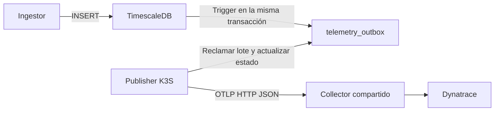

# OTLogger Publisher 0.1.0 (validación DEV pendiente)

Proceso independiente que publica CPU y RAM desde una outbox PostgreSQL hacia
el Collector compartido. No usa CSV ni kubectl para la operación continua.

## Preparación DEV

1. Revisar esquema y versión reales en `idl/kepserver_pcn`. Aplicar una vez
   `migrations/001_cpu_ram_outbox.sql` con psql y ON_ERROR_STOP. La migración
   requiere tablas CPU/RAM existentes. No convierte la columna temporal de tags.
2. La migración instala triggers y agrega sample_id UUID a nuevas muestras.
   El histórico previo queda sin UUID y no se publica automáticamente.
   El ingestor actualizado detecta las columnas sample_id y asigna UUID estables
   al lote antes de escribir, conservándolos durante sus reintentos. En versiones
   antiguas el default SQL genera el UUID, sin deduplicar reintentos ambiguos. Sus escritores deben poder
   insertar en la outbox (el trigger no eleva privilegios).
3. Crear credenciales dedicadas. El publisher requiere SELECT/UPDATE/DELETE
   sobre telemetry_outbox y conexión a la base; no requiere leer otras tablas,
   crear esquema ni permisos de superusuario. La outbox ya incluye el payload
   y sobrevive independientemente de la retención de las hypertables.
4. Crear Secret `otlogger-publisher-db` con PGHOST, PGPORT, PGDATABASE,
   PGUSER, PGPASSWORD. Usar el Service TimescaleDB real. No guardar secretos
   en Git ni copiar las credenciales del administrador.
5. Construir desde la raíz: `docker build -f publisher/Dockerfile -t
   otlogger-publisher:0.1.0 .` y cargar la imagen según el procedimiento edge.
6. Ajustar `k3s/deployment.yaml`: imagen, nodo si solo uno tiene la imagen
   importada, Service DB, endpoint e identidad del servidor medido. Aplicar
   únicamente ese manifiesto, sin desplegar otra TimescaleDB.

La outbox empieza a acumular desde que se instala la migración. Asegurar
espacio y monitoreo antes de dejarla activa. Ante problemas, detener el publisher
no detiene su acumulación. Para deshabilitar la captura de pendientes, planificar
la retirada de los triggers con el propietario de la base; eso rompe la cobertura
de ese intervalo. No eliminar la outbox con pendientes.

## Política y operación

- Una réplica inicial, estrategia Recreate. Reclamo con SKIP LOCKED y token de
  intento: una confirmación anterior no actualiza un intento nuevo.
- Lease 120 s, timeout HTTP 15 s, reintentos hasta 300 s. Una pérdida de ACK
  puede duplicar puntos; Dynatrace no deduplica por sample_id automáticamente.
- ACK completo del Collector se llama collector_accepted, no entrega final.
- Rechazo parcial: reintentar lote completo, con posibles duplicados.
- HTTP no reintentable: rejected para revisión, sin limpieza automática.
- Datos de una hora o más: expired, sin cambiar timestamps ni borrarlos.
- Limpieza interna de hasta 1000 aceptados por ciclo, después de 48 h.
  No borra el histórico ni pendientes/expirados/rechazados.
- El volumen persistente es el de PostgreSQL; el publisher no guarda estado en
  su sistema de archivos. La protección frente a pérdida de nodo depende de DB.
- Conteos por estado y resultados de lotes en logs. Antes de uso productivo:
  conectar alertas, medir bytes/crecimiento de outbox y definir política de disco
  lleno y vencidos con Reliability. Hoy no hay un límite automático de tamaño:
  no se promete retención ilimitada ni pérdida cero al agotar el disco.
- Identidad del servidor medido: OTLOGGER_SOURCE. El Collector agrega edge,
  entorno y Kubernetes. UUID queda en DB, no como dimensión de métrica.

Variables: OTEL_EXPORTER_OTLP_METRICS_ENDPOINT (URL completa), OTEL_SERVICE_NAME,
OTLOGGER_SOURCE, POD_UID, PUBLISH_BATCH_SIZE (100), PUBLISH_POLL_SECONDS (5),
PUBLISH_MAX_AGE_SECONDS (3600), y variables libpq PG*.

## Verificación

`python3 -m unittest discover -s tests` cubre conversión y ACKs. Se verificó en
PostgreSQL 18 temporal la migración y atomicidad de inserción/rollback. Falta
validación sobre TimescaleDB real, lease/reinicio/concurrencia end-to-end y corte
con recuperación contra Collector/Dynatrace. La imagen no se construyó ni el
Deployment se aplicó desde este equipo. El piloto anterior validó un único lote.

## Compatibilidad con main actual

El ingestor usa suscripciones y `insert_many`. El publisher sigue limitado a
CPU/RAM: sus columnas no cambiaron. `tags.address`, `heartbeat_rtt` y `agent_logs`
se conservan pero no se exportan automáticamente. Las nuevas métricas OPC UA
viajan en nodos `.batch`; usar los ejemplos de settings y layout de esta revisión
si se actualiza el ingestor. No reemplazar la configuración viva sin adaptarla.
La captura JSON se emite después del commit del lote en `Ingest.flush`.
Los triggers de outbox se ejecutan AFTER INSERT y las muestras nuevas tienen
índices únicos `(timestamp,sample_id)` para no duplicar outbox en conflictos.
